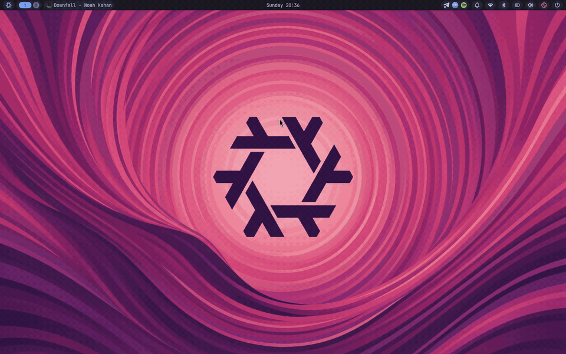

# nixos-config

My personal NixOS setup using dendritic architecture ([import-tree](https://github.com/denful/import-tree) + [flake-parts](https://flake.parts/)).

<p align="center">
  
</p>

## Hosts

- **`loki`** — Daily driver laptop (Intel Alder Lake / Iris Xe).
- **`vm`** — QEMU/virt-manager guest for testing configs safely.

## The Setup

- **Compositor:** [Niri](https://github.com/YaLTeR/niri) (scrollable-tiling Wayland compositor)
- **Desktop Shell:** [Noctalia](https://github.com/noctalia-dev/noctalia) (bar, widgets, lockscreen)
- **Terminal:** Alacritty
- **Shell:** Fish + Starship
- **Editor:** Neovim (LazyVim)
- **Key Remap:** `keyd` (Caps Lock = Esc when tapped, Ctrl when held)
- **Browser:** [Zen Browser](https://zen-browser.app)

## Rebuilding

```bash
# Rebuild laptop
sudo nixos-rebuild switch --flake .#loki --accept-flake-config

# Rebuild VM
sudo nixos-rebuild switch --flake .#vm --accept-flake-config
```
